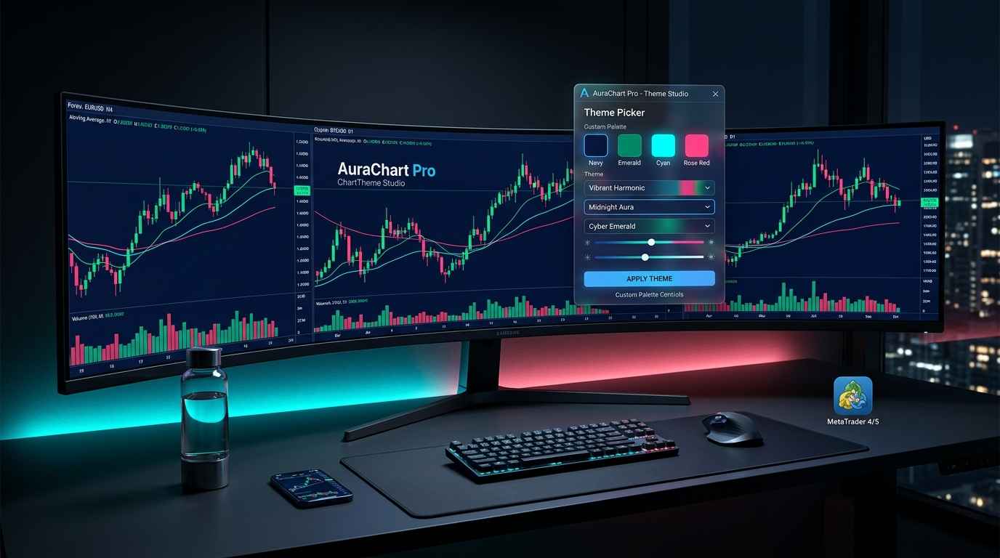

# 🌌 استودیو تم چارت | AuraChart Studio™ (ChartTheme Studio Pro)
> **پیشرفته‌ترین سیستم مدیریت تم، ارگونومی بصری و استایل خودکار چارت برای MetaTrader 4 و MetaTrader 5**  
> توسعه‌داده‌شده توسط: **[شایان نماینده | Shayan Namayandeh (SudoShayanNA)](https://github.com/roseshayan)**

---

[ [English Documentation](README.md) ] | [ فارسی ] | [ [مشاهده آنلاین لندینگ پیج](https://roseshayan.github.io/AuraChart-Studio/) ]

---

> ### ⚠️ سلب مسئولیت و شفاف‌سازی: ابزار ۱۰۰٪ غیرمعاملاتی
> **AuraChart Studio™** صرفاً یک دستیار بصری، ارگونومیک و استایل‌دهی ظاهر چارت است. این برنامه **به هیچ عنوان معامله‌ای باز یا بسته نمی‌کند**، هیچ سفارشی را مدیریت نمی‌کند و **هیچ‌گونه تاثیری در معاملات شما ندارد**.

---

## 📖 معرفی محصول

ابزار **AuraChart Studio™** (که با نام *ChartTheme Studio Pro* نیز شناخته می‌شود) یک دستیار گرافیکی هوشمند (Expert Advisor غیرمعاملاتی) است که به طور اختصاصی برای حل معضل خستگی چشم، ظاهر قدیمی و عدم هماهنگی رنگ‌های پیش‌فرض ترمینال‌های متاتریدر ۴ و ۵ توسعه یافته است.

این محصول به تریدرها و تحلیل‌گران حرفه‌ای اجازه می‌دهد تنها با یک کلیک یا با استفاده از کلیدهای میانبر، کل محیط تحلیلی خود را به **۱۶ پالت رنگی مدرن و استاندارد (۸ تم تاریک و ۸ تم روشن)** تغییر دهند؛ همچنین تمامی خطوط روند، باکس‌ها و ابزارهای ترسیم‌شده به صورت هوشمند و خودکار با تم فعال هماهنگ می‌شوند.

---

## 💎 امکانات و قابلیت‌های کلیدی

### ۱. ۱۶ پالت رنگی اختصاصی و ارگونومیک
- **۸ تم تاریک (Dark Themes):**
  - **Midnight Navy:** سرمه‌ای عمیق و شیک `#0F172A` با کندل‌های فیروزه‌ای و زرشکی نئونی.
  - **Obsidian Black:** مشکی خالص با کنتراست بالای سبز نعنایی و قرمز آتشی.
  - **Nord Dark:** الهام‌گرفته از سیستم طراحی مشهور Nord با طیف سرد و ملایم قطبی.
  - **Monokai Trader:** استایل محبوب ادیتورهای برنامه‌نویسی با تمایز فوق‌العاده کندل‌ها.
  - **Deep Ocean:** آبی اقیانوسی ژرف با جزئیات آکوا بیولومینسنت.
  - **Emerald Night:** پس‌زمینه جنگل کاج با سبز زمردی آرامش‌بخش.
  - **Dark Graphite:** طراحی مینیمالیستی خاکستری تیره با الهام از رابط‌های اپل.
  - **Burgundy Night:** مخمل تیره شرابی با جزئیات یشمی و صورتی تمشکی.
- **۸ تم روشن (Light Themes):**
  - **Arctic White:** سفید استودیویی تمیز با کنتراست استاندارد و متن‌های دودی خوانا.
  - **Ivory Pro:** سفید عاجی و کرم ملایم همراه با سبز فیروزه‌ای تیره.
  - **Paper Trading:** حس لمس روزنامه مالی و کاغذ با خطوط جوهر کلاسیک.
  - **Soft Silver:** نقره‌ای و خاکستری مات مدرن مناسب برای ساعات طولانی در روز.
  - **Morning Sky:** سفید با تون آبی روشن Alice Blue و کندل‌های نارنجی ملایم.
  - **Sage Light:** پاستلی مریم‌گلی برای کاهش استرس در تایم‌فریم‌های شلوغ.
  - **Sandstone:** خاکی و ماسه‌ای با رنگ‌های گرم پاییزی.
  - **Minimal Light:** مشکی-سفید مدرن با رنگ صعودی آبی الکتریک.

### ۲. استایل‌دهی خودکار به اشیاء و ابزارهای رسم (Auto-Styling)
- به محض کشیدن هرگونه **خط روند (Trendline)، خطوط افقی و عمودی، باکس و مستطیل (Rectangle)، کانال‌ها، فلش‌ها و سطوح فیبوناچی (Fibonacci)**، رنگ آن‌ها بلافاصله با پالت جاری هماهنگ می‌شود.
- هنگام تعویض تم، تمامی اشیاء رسم‌شده موجود روی چارت به طور خودکار به رنگ‌های پالت جدید تغییر می‌کنند.

### ۳. پنل متحرک روی چارت (Draggable Floating HUD)
- امکان جابه‌جایی آزادانه پنل با کشیدن نوار بالای آن (Drag & Drop) بدون نیاز به تنظیم مجدد پارامترها.
- پشتیبانی از حالت کامل (Full HUD) با نمایش پالت و جزئیات رنگ، و حالت بسیار فشرده (Compact Floating Pill) که کمترین فضای چارت را اشغال می‌کند.
- ذخیره هوشمند آخرین موقعیت مکانی پنل در هر چارت.

### ۴. اعمال هم‌زمان روی تمام چارت‌های باز (Apply to All Charts)
- قابلیت تغییر رنگ تمام چارت‌های فعال ترمینال بدون نیاز به نصب یا دستکاری تک‌تک آن‌ها.

### ۵. ماندگاری تنظیمات و بازگردانی سریع (Backup & Rollback)
- ثبت و ذخیره وضعیت اولیه چارت قبل از تغییرات، با امکان بازگردانی کامل به حالت اولیه تنها با کلیک روی دکمه `Reset Init`.
- ذخیره خودکار تم انتخاب‌شده در متغیرهای سراسری متاتریدر.

### ۶. امنیت ۱۰۰٪ و بدون عملیات معاملاتی
- این اکسپرت به هیچ وجه معامله باز یا بسته نمی‌کند، حد ضرر و سود را تغییر نمی‌دهد، از هیچ DLL خارجی استفاده نمی‌کند و به اینترنت متصل نمی‌شود.

---

## 🛠️ راهنمای نصب و راه‌اندازی

### در متاتریدر ۵ (MT5):
1. در متاتریدر ۵، از منوی بالا روی **File -> Open Data Folder** کلیک کنید.
2. وارد پوشه `MQL5/Experts` شوید.
3. فایل‌های `ChartThemeStudio_MT5.mq5` و `ChartThemeStudio_MT5.ex5` را در این پوشه کپی کنید.
4. در متاتریدر کلید `Ctrl+N` را بزنید تا پنجره **Navigator** باز شود؛ روی بخش **Expert Advisors** راست‌کلیک کرده و **Refresh** را انتخاب کنید.
5. اکسپرت **ChartThemeStudio_MT5** را به روی چارت بکشید (Drag & Drop) و `OK` بزنید.

### در متاتریدر ۴ (MT4):
1. در متاتریدر ۴، از منوی بالا روی **File -> Open Data Folder** کلیک کنید.
2. وارد پوشه `MQL4/Experts` شوید.
3. فایل `ChartThemeStudio_MT4.mq4` را در این پوشه کپی کنید.
4. با زدن کلید `F4` وارد برنامه **MetaEditor** شوید، فایل را باز کرده و کلید `F7` (Compile) را بزنید تا فایل `.ex4` ساخته شود.
5. در پنجره Navigator متاتریدر ۴ رفرش کرده و اکسپرت را روی چارت اجرا نمایید.

---

## ⌨️ کلیدهای میانبر (Hotkeys)

| کلید | عملکرد |
|:---:|:---|
| `T` | رفتن به تم بعدی (Next Theme) |
| `Y` | بازگشت به تم قبلی (Previous Theme) |
| `R` | انتخاب تصادفی هوشمند (Intelligent Random) |
| `G` | روشن/خاموش کردن خطوط شبکه (Toggle Grid) |

---

## ⚙️ جدول تنظیمات ورودی (Inputs)

| نام ورودی | نوع داده | پیش‌فرض | توضیحات کاربردی |
|:---|:---:|:---:|:---|
| `InpInitialTheme` | Enum | `THEME_MIDNIGHT_NAVY` | تم اولیه هنگام اتصال به چارت |
| `InpRestoreSavedTheme` | bool | `true` | بازیابی خودکار آخرین تم ذخیره‌شده |
| `InpAutoSaveSettings` | bool | `true` | ذخیره خودکار تغییرات در حافظه ترمینال |
| `InpApplyToAllOpenCharts` | bool | `false` | اعمال تم به تمام چارت‌های باز |
| `InpStyleDrawnObjects` | bool | `true` | استایل‌دهی خودکار به خطوط و اشکال رسم‌شده |
| `InpShowPanel` | bool | `true` | نمایش پنل کنترل روی چارت |
| `InpStartCompact` | bool | `false` | باز شدن پنل در حالت مینی‌مال فشرده |
| `InpEnableDragging` | bool | `true` | امکان کشیدن و جابه‌جایی آزاد پنل با ماوس |
| `InpEnableHotkeys` | bool | `true` | فعال‌سازی کلیدهای میانبر کیبورد |
| `InpDeinitAction` | Enum | `DEINIT_RESTORE_ORIGINAL` | بازگردانی ظاهر چارت هنگام حذف اکسپرت |

---

## 👤 سازنده و ارتباط

توسعه‌داده‌شده با افتخار توسط:  
**شایان نماینده (Shayan Namayandeh - SudoShayanNA)**  
*توسعه‌دهنده ارشد سیستم‌های الگوریتمی مالی و زبان‌های MQL4/MQL5*

- 🌐 **پروفایل گیت‌هاب:** [github.com/roseshayan](https://github.com/roseshayan)
- 📦 **مخزن پروژه در گیت‌هاب:** [github.com/roseshayan/AuraChart-Studio](https://github.com/roseshayan/AuraChart-Studio)
- ✈️ **تلگرام:** [@SudoShayanNA](https://t.me/SudoShayanNA)
- ✉️ **ایمیل مستقیم:** [namayandeshayan@gmail.com](mailto:namayandeshayan@gmail.com)

---

## 📜 مجوز (License)
این پروژه تحت مجوز متن‌باز **MIT** منتشر شده است. استفاده، بهینه‌سازی و شخصی‌سازی آن برای مصارف شخصی یا تجاری آزاد است.
